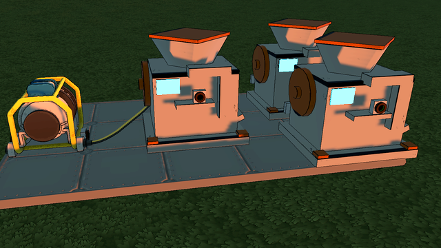

# Stellar Industries — StellarDrive Demo

Extension industrielle pour StellarDrive Demo, inspirée des jeux d'automatisation : extraire,
transformer, fabriquer, alimenter, transporter. Développée par étapes ; chaque version ne
déclare opérationnel que ce qui a été vérifié dans le jeu.

**Version 0.2.0 — phases A et C.** Voir le [rapport de faisabilité](docs/FAISABILITE.md)
pour ce que le jeu permet réellement, et la [feuille de route](docs/FAISABILITE.md#f-stratégie-de-livraison).



## Ce qui fonctionne

| Fonction | État |
|---|---|
| **Atelier industriel** (onglet « Industrie ») : 10 emplacements, prise électrique à l'arrière, 300 W | ✅ testé en jeu |
| Recettes de l'atelier : plaques, tiges, fil de cuivre (lingots, ou minerai brut moins rentable) | ✅ testé en jeu |
| Ne produit que s'il a de l'énergie, de la matière **et** de la place ; rien n'est consommé sans être produit | ✅ testé en jeu |
| Énergie : consomme sur le réseau électrique du jeu (le générateur brûle plus de bois), ralentit si le réseau manque de puissance | ✅ testé en jeu (énergie insuffisante : non testé) |
| Sauvegarde : contenu identique après rechargement, production qui reprend | ✅ testé en jeu |
| **Fonderie, Presse, Broyeur, Assembleuse** : lingots, tiges, vis, câbles, tôles, plaques renforcées, minerai broyé (meilleur rendement) | ✅ testé en jeu |
| **Choix de recette** (touche `N` en visant la machine), conservé dans la sauvegarde | ✅ testé en jeu (touche : non testée à la main) |
| Panneau d'état en visant une machine (état, recette, progression, énergie, contenu, mode) | ✅ affichage vérifié par capture |
| Multijoueur | ⚠️ conçu pour (l'hôte seul simule), **non testé** |

Utilisation : posez une machine, reliez sa prise arrière à un générateur avec un câble électrique,
ouvrez-la (touche utiliser) et déposez la matière. Les produits s'empilent dans les derniers
emplacements. En visant la machine, `N` choisit sa recette (automatique ou une seule).

Chaîne de base : minerai → **Fonderie** → lingots → **Atelier** → plaques, tiges, fil →
**Presse** → vis, câbles → **Assembleuse** → plaques renforcées. Le **Broyeur** double le
minerai avant la fonderie (+33 % de lingots).

## Limitations connues

- Le cycle en cours repart de zéro après un rechargement (aucun objet perdu).
- 10 emplacements par machine (limite du stockage du jeu).
- Chez un client, le panneau dépend des réponses de l'hôte (non testé à deux joueurs).
- Pas encore d'extraction, de convoyeurs, de recherche ni de fluides (phases suivantes).

## Installation

1. Installer **SDModKit** (gestionnaire de mods StellarModManager).
2. Copier `StellarIndustries.dll` dans `StellarDrive Demo/Mods/` (ou via le gestionnaire).
3. Tous les joueurs d'une partie doivent avoir le mod.

## Désinstallation

Avant de retirer la DLL : faites une copie de votre sauvegarde, videz les ateliers et coffres
des objets du mod, recyclez les ateliers, sauvegardez. Sinon les ateliers disparaissent avec
leur contenu au chargement suivant. Voir [compatibilité](docs/COMPATIBILITE.md).
Pour simplement arrêter la production : `Enabled = false` dans la section
`[StellarIndustries]` de `UserData/MelonPreferences.cfg`.

## Compilation

Prérequis : .NET SDK 8, le jeu installé avec MelonLoader 0.7.3 et SDModKit. Le chemin du jeu est
dans `Directory.Build.props` (`GamePath`, surchargeable par `Directory.Build.props.user` ou
`-p:GamePath=...`). Aucune DLL du jeu n'est commitée.

```
dotnet build src/StellarIndustries/StellarIndustries.csproj -c Release   # copie aussi la DLL dans Mods/
dotnet test tests/StellarIndustries.Tests                                # tests sans le jeu
powershell tools/package.ps1                                             # zip pour une release
```

## Documentation

- [Rapport de faisabilité et architecture](docs/FAISABILITE.md)
- [Ajouter une ressource, une machine, une recette ; réglages](docs/GUIDE-CONTENU.md)
- [Compatibilité sauvegardes, multijoueur, autres mods](docs/COMPATIBILITE.md)
- [Tests](docs/TESTS.md)
- [Journal des changements](CHANGELOG.md)

Mécaniques inspirées des jeux d'automatisation ; aucun modèle, texture, son, nom ou code d'un
autre jeu n'est utilisé. Les modèles sont construits par le mod avec les matériaux de StellarDrive.
