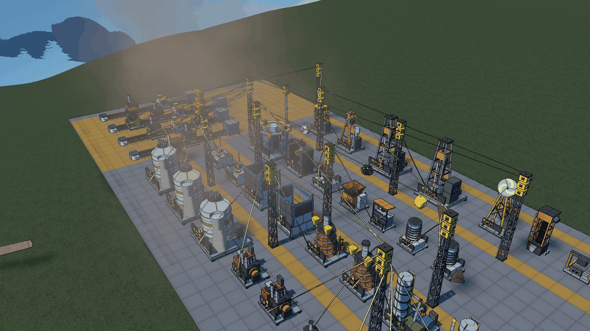

# Stellar Industries

*[English below](#english)*

Un mod d'industrie pour **StellarDrive Demo**. Vous partez de quelques lingots de fer, et petit à petit vous montez une vraie usine : des machines qui extraient le minerai, le fondent, le façonnent et l'assemblent, des générateurs pour tout alimenter, des lignes d'objets pour faire circuler la production… jusqu'à l'accélérateur de particules et au réacteur stellaire.

## Ce que vous y trouverez

- **30 machines et 3 poteaux électriques** dans trois onglets de construction :
  - « Industrie » : atelier, fonderie, presse, broyeur, assembleuse, fabricateur, haut fourneau, raffinerie, accélérateur de particules, encodeur quantique et convertisseur ;
  - « Industrie+ » : brûleur à biomasse, générateur à combustion, réacteur stellaire, accumulateur, extracteurs Mk1 et Mk2, foreuse de gisement, condenseur d'eau, tour radar, conteneur, quai de transfert, recycleur, comptoir d'échange et poteaux électriques ;
  - « Convoyeurs » : tapis Mk1 à Mk3, élévateur, répartiteur et fusionneur.
- **73 objets et 88 recettes**, des plaques de fer aux cristaux temporels, dont cinq minerais à trouver dans le monde (charbon, soufre, calcaire, quartz, or) et des gisements inépuisables.
- **Recycler et échanger** : le recycleur paie vos surplus en bons, le comptoir les échange contre des ressources.
- **Convoyeurs** : tapis Mk1 à Mk3, élévateur, répartiteur et fusionneur, branchés directement sur les machines.
- **Poteaux électriques** de 4 à 12 branchements.
- **Scanners de gisements** Mk1 à Mk3 avec modules, et des gisements de pureté variable.
- **Une branche de recherche** : chaque niveau se paie avec ce que vous fabriquez déjà, ce qui vous fait remonter la chaîne naturellement.
- **Des machines vivantes** : volants qui tournent, presses qui frappent, bras robotisés, fours qui rougeoient, voyant vert quand tout va bien, et un léger ronronnement quand on passe à côté.
- **Un wiki dans le jeu** : appuyez sur **G**, entrée « Wiki Stellar Industries ». Chaque machine et chaque objet a sa fiche.
- **Français et anglais** : le mod suit la langue du jeu.

Toutes les machines se branchent sur le réseau électrique du jeu et leur contenu est sauvegardé avec votre partie. Une machine ne consomme ses ingrédients qu'à la fin d'un cycle, et seulement si elle a la place de ranger le résultat : vous ne perdez jamais rien.

## Pour commencer

1. À la table de recherche, après *Power Generation*, recherchez **Industrie de base**.
2. Posez une **fonderie** et un **atelier**, et branchez la prise à l'arrière de chacun sur un générateur.
3. Mettez du minerai de fer dans la fonderie, puis les lingots dans l'atelier : voilà vos premières plaques.
4. Regardez une machine pour voir ce qu'elle fait, et appuyez sur **N** pour changer sa recette.

Pour aller plus loin, tout est expliqué dans le wiki du jeu (touche G).

## Touches

| Touche | Effet |
|---|---|
| Regarder une machine | son état, sa recette, son énergie, son contenu |
| `N` | changer de recette (Maj+N : revenir en arrière) |
| `K` | repérer les rochers minables autour de vous |
| `F7` | le tableau de bord de toute l'usine |
| `G` | le guide du jeu, avec le wiki du mod |

## Installation

1. Installez **SDModKit** depuis StellarModManager.
2. Installez **Stellar Industries** depuis StellarModManager.
3. Facultatif mais conseillé : **Item Lines**, pour relier les machines entre elles.

En multijoueur, tout le monde doit avoir le mod. Le jeu à plusieurs n'a pas encore été beaucoup testé : n'hésitez pas à signaler les soucis.

Pour désinstaller proprement, videz et recyclez vos machines avant de retirer le mod (et gardez une copie de votre sauvegarde).

## À savoir

- Chaque machine a 10 emplacements, comme les coffres du jeu.
- Pas de fluides en tuyaux, de trains ni de drones : le jeu ne le permet pas (le condenseur d'eau remplace la pompe). Pour transporter, un cargo piloté et deux quais de transfert font très bien l'affaire.
- Un cycle commencé repart de zéro quand on recharge la partie (sans perte d'objets).
- Depuis 0.12, certaines machines sont plus grandes : dans une ancienne partie, une machine peut chevaucher sa voisine. Déplacez-la si besoin.

---

## English

An industry mod for **StellarDrive Demo**. You start with a handful of iron ingots and slowly build up a real factory: machines that dig ore, smelt it, shape it and put it together, generators to keep everything running, item lines to move your production around… all the way to a particle accelerator and a stellar reactor.

### What's inside

- **30 machines and 3 power poles** in three build tabs:
  - "Industrie": workshop, smelter, press, crusher, assembler, fabricator, blast furnace, refinery, particle accelerator, quantum encoder and converter;
  - "Industrie+": biomass burner, combustion generator, stellar reactor, accumulator, extractors Mk1 and Mk2, deposit drill, water condenser, radar tower, container, transfer dock, recycler, exchange counter and power poles;
  - "Convoyeurs": belts Mk1 to Mk3, lift, splitter and merger.
- **73 items and 88 recipes**, from iron plates to time crystals, including five ores to find in the world (coal, sulfur, limestone, quartz, gold) and inexhaustible deposits.
- **Recycle and trade**: the recycler pays for your surplus in vouchers, the exchange counter trades them for resources.
- **Conveyors**: Mk1 to Mk3 belts, a lift, a splitter and a merger, linked straight to the machines.
- **Power poles** with 4 to 12 connections.
- **Deposit scanners** Mk1 to Mk3 with modules, and deposits of varying purity.
- **A research branch**: each level is paid with what you already make, so you naturally climb up the chain.
- **Machines that feel alive**: spinning flywheels, stamping presses, robot arms, glowing furnaces, a green light when all is well, and a gentle hum as you walk by.
- **An in-game wiki**: press **G** and pick "Wiki Stellar Industries". Every machine and every item has its own page.
- **English and French**: the mod follows the game's language.

Every machine plugs into the game's power grid and its contents are saved with your game. A machine only uses its ingredients at the end of a cycle, and only if it has room for the result: you never lose anything.

### Getting started

1. At the research table, after *Power Generation*, research **Basic Industry**.
2. Place a **smelter** and a **workshop**, and plug the socket on the back of each one into a generator.
3. Put iron ore in the smelter, then the ingots in the workshop: there are your first plates.
4. Look at a machine to see what it is doing, and press **N** to change its recipe.

Everything else is explained in the in-game wiki (G key).

### Keys

| Key | What it does |
|---|---|
| Look at a machine | its state, recipe, power and contents |
| `N` | change recipe (Shift+N: go back) |
| `K` | spot the minable rocks around you |
| `F7` | the whole factory at a glance |
| `G` | the game's guide, with the mod's wiki |

### Installing

1. Install **SDModKit** from StellarModManager.
2. Install **Stellar Industries** from StellarModManager.
3. Optional but recommended: **Item Lines**, to link machines together.

In multiplayer everyone needs the mod. Playing together hasn't been tested much yet, so please report any trouble.

To uninstall cleanly, empty and recycle your machines before removing the mod (and keep a copy of your save).

### Good to know

- Each machine has 10 slots, like the game's chests.
- No piped fluids, trains or drones: the game doesn't allow them (the water condenser stands in for a pump). For transport, a piloted cargo ship and two transfer docks do the job nicely.
- A cycle in progress restarts when you reload your game (no items are lost).
- Since 0.12 some machines are bigger: in an older save a machine may overlap its neighbour. Move it if needed.

---

Made by **Romalaure**. Building the mod yourself, adding content or running the tests: see [docs/](docs/GUIDE-CONTENU.md).
